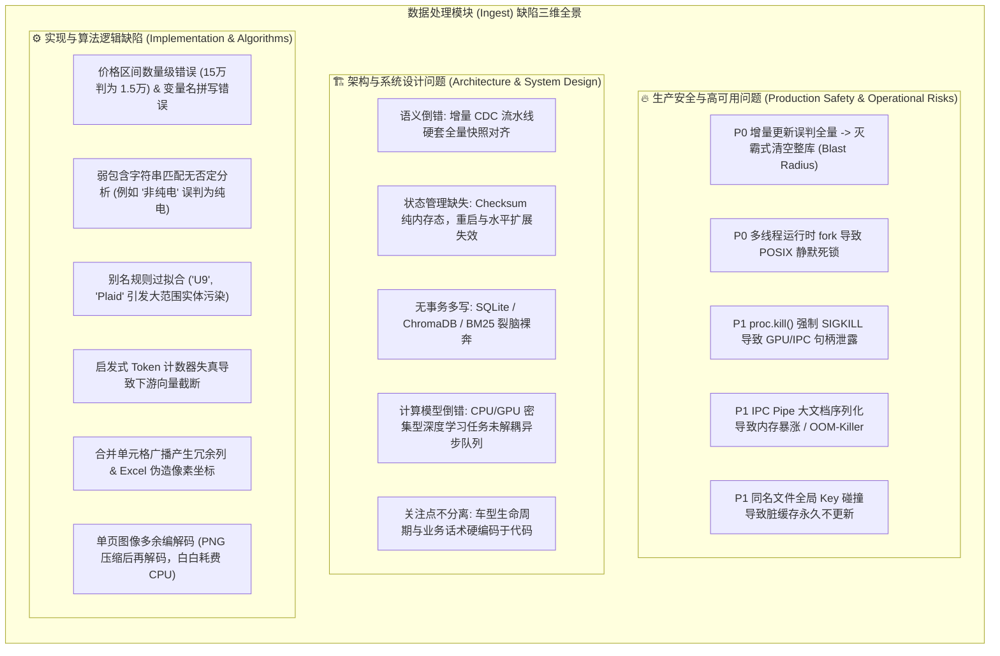
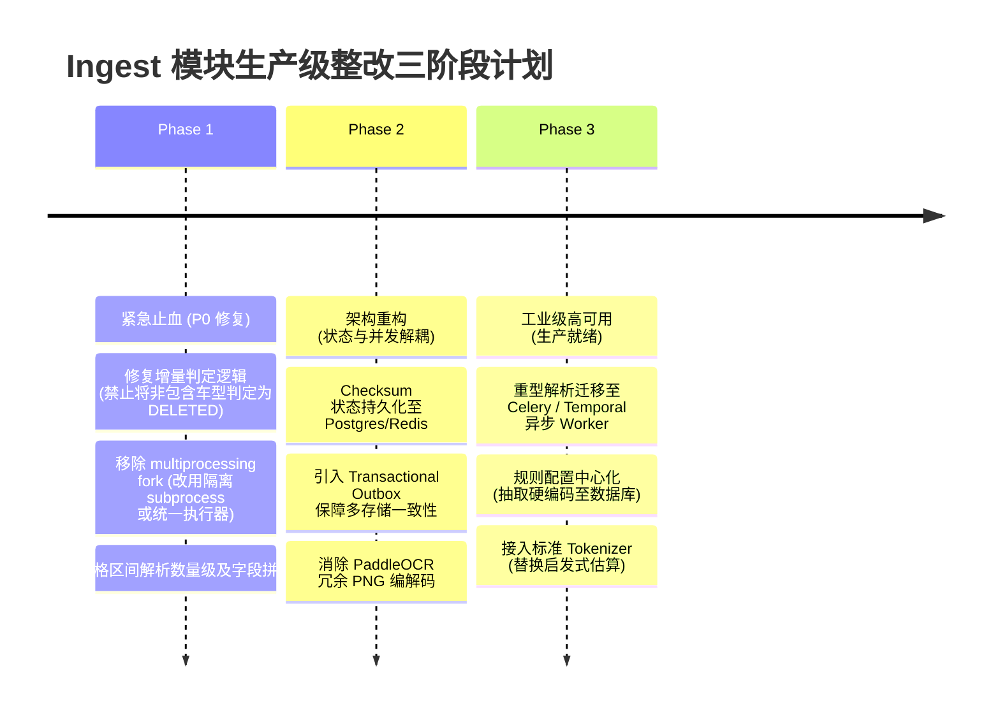

# AutoVend 数据接入模块（Ingest）工程架构与生产安全审计报告
# Engineering Architecture & Production Safety Audit: AutoVend Data Ingestion

- **评估对象**: `src/ingestion/` 核心数据接入与解析流水线
- **核心文件**:
  - `src/ingestion/pipeline.py` (增量摄入与多索引同步流水线)
  - `src/ingestion/layout_parser.py` (版面感知文档与表格解析引擎)
  - `src/ingestion/multiformat_parser.py` (多格式文档解析引擎)
  - `src/ingestion/unstructured_parser.py` (非结构化解析与 TOML 提取引擎)
  - `src/ingestion/hierarchical_chunker.py` (层次化语义分块器)
  - `src/ingestion/freshness.py` (数据新鲜度与生命周期引擎)
  - `src/ingestion/paddle_ocr_adapter.py` (PaddleOCR PP-Structure 适配器)
  - `src/ingestion/docling_adapter.py` (IBM Docling 适配器)
- **审计评级**: **高危 (High Risk - 生产阻断级缺陷存在)**
- **主要结论**: 模块在学术/原型概念（如双轨降级、分层分块、多格式支持）上设计全面，但在基础工程实现、分布式状态管理、多存储一致性及并发安全层面存在多处致命缺陷，不能直接投入高并发、多实例生产环境。

---

## 目录
1. [分类概览矩阵](#1-分类概览矩阵)
2. [第一部分：生产安全与高可用问题 (P0 / P1)](#2-第一部分生产安全与高可用问题-p0--p1)
3. [第二部分：架构与系统设计问题](#3-第二部分架构与系统设计问题)
4. [第三部分：实现与算法逻辑缺陷](#4-第三部分实现与算法逻辑缺陷)
5. [第四部分：工业级整改与落地路线图](#5-第四部分工业级整改与落地路线图)

---

## 1. 分类概览矩阵



---

## 2. 第一部分：生产安全与高可用问题 (P0 / P1)

### 2.1 [P0] 增量同步语义混淆引发“灭霸级”整库物理删除
- **定位**: `src/ingestion/pipeline.py:138-147`
- **代码片段**:
  ```python
  # detect_changes 遍历所有历史缓存的车型
  for old_model in list(self.checksum_store.keys()):
      if old_model not in incoming_models:
          patches.append(
              VehicleDataPatch(
                  car_model=old_model,
                  change_type=ChangeType.DELETED,
                  checksum="",
              )
          )
  ```
- **机理分析**:
  - `ingest_batch` 是为高频增量数据准备的入口（例如爬虫捕获的 5 款车型调价事件）。
  - 当上游传入 5 个车型的增量微批（Micro-batch）时，`incoming_models` 仅包含这 5 款车型。
  - 代码直接认定“未在当前批次出现的既有车型全部已下线”，批量生成 `DELETED` 补丁，紧接着在 `src/ingestion/pipeline.py:180-189` 中调用 `self.db.delete_vehicle(patch.car_model)`，并将向量库与新鲜度引擎标记为 Tombstone。
  - **单测证据**: `tests/test_ingestion_pipeline.py:22-37` 明确将“第二批不传 Model B，Model B 被删除”视作预期行为，证实此逻辑并非偶发 Bug，而是设计认知偏差。
- **爆炸半径与业务危害**: 一次日常的微批增量同步，将直接物理抹除数据库中其余数千款历史车型的规格参数、向量索引与结构化数据。
- **整改方案**:
  1. 严格解耦 **增量变更摄入（CDC Upsert）** 与 **全量快照对齐（Snapshot Reconciliation）**。
  2. 默认增量模式下，仅处理批次内的 `INSERT/UPDATE`，除非数据显式携带 `is_deleted=True` 软删除标识，否则严禁触发删除。
  3. 全量对账必须通过专用接口（如 `reconcile_full_catalog()`），并设置安全删除阈值（例如单次删除比例超过 5% 时熔断报警并拒绝执行）。

---

### 2.2 [P0] 多线程环境下使用 `mp.get_context("fork")` 引发 POSIX 级静默死锁
- **定位**: `src/ingestion/layout_parser.py:2514`
- **代码片段**:
  ```python
  try:
      ctx = mp.get_context("fork")
  except ValueError:
      ctx = mp.get_context()
  parent_conn, child_conn = ctx.Pipe()
  ```
- **机理分析**:
  - AutoVend 服务在主进程中引入了 PyTorch (Docling/TableFormer)、OpenCV、PaddlePaddle 以及 PyMuPDF (fitz)，底层均为使用 OpenMP / POSIX 线程池的 C++ 动态链接库。
  - 在 POSIX 标准中，在多线程程序中调用 `fork()` 只会复制发起调用的当前线程，其他线程的内部状态、锁（`pthread_mutex`）在子进程中处于“被持有但持有者不存在”的僵死状态。
  - 一旦子进程执行到任何需要获取该锁的底层代码（如内存分配器 `glibc malloc` 锁、OpenMP 运行时锁或 CUDA 上下文锁），子进程将**永久静默卡死（Deadlock）**，没有任何 Python 异常抛出，只有超时后被杀。
  - Python 3.12 官方已将多线程环境下的 `fork` 标记为废弃（Deprecated）并在未来版本禁用。
- **业务危害**: 在多请求并发场景下，解析进程随机 hang 死，导致解析线程池全部耗尽，服务响应延迟无限飙升至整体瘫痪。
- **整改方案**:
  1. 禁用 `fork` 上下文，切换为 `spawn` 或 `forkserver`。
  2. 将重型 OCR / 版面模型隔离到独立的 RPC 微服务中（如通过 gRPC / REST 与主服务通信），严禁在 Web 应用主进程空间内频繁 fork 进程。

---

### 2.3 [P1] 进程超时 `SIGKILL` 强杀引发 GPU/IPC 资源泄露与驱动级污染
- **定位**: `src/ingestion/layout_parser.py:2537`
- **代码片段**:
  ```python
  if proc.is_alive():
      proc.kill()
      proc.join(timeout=2.0)
      parent_conn.close()
  ```
- **机理分析**:
  - `proc.kill()` 向子进程发送的是操作系统级 `SIGKILL`（信号 9）。
  - `SIGKILL` 会立即终止进程，**完全跳过**所有 Python 级别的 `finally` 块、上下文管理器析构以及 C/C++ 析构函数。
  - 如果子进程超时被杀时正在使用 GPU 显存或访问 Linux 共享内存（POSIX Shared Memory），显存句柄可能变成孤儿，无法返还给驱动；临时创建的切片文件（如 `autovend_slice_` 目录）将残留在磁盘上，引发存储与显存的持续泄漏。
- **整改方案**:
  - 优先发送优雅终止信号 `SIGTERM`，给子进程 3~5 秒清理资源与临时文件的窗口；只有在超时未响应时才降级为 `SIGKILL`。
  - 为子进程注入看门狗定时器，让子进程内部实现自杀与资源清理协议。

---

### 2.4 [P1] IPC 管道跨进程传递庞大对象图引发 OOM-Killer
- **定位**: `src/ingestion/layout_parser.py:2523`
- **代码片段**:
  ```python
  res = func(*args, **kwargs)
  child_conn.send((True, res))
  ```
- **机理分析**:
  - `ctx.Pipe()` 依赖底层操作系统管道缓冲区（通常默认仅 64KB）。
  - 文档解析生成的 `ParsedDocument` 包含数百个单元格、坐标矩阵、高维表格与提取文本，形成一个巨大的 Python 对象图。
  - `send()` 在序列化大对象时，会一次性在内存中生成巨型字节流。若父进程反序列化跟不上，或多份大文档同时通过 Pipe 传输，将产生多倍内存峰值，导致容器瞬间被 Linux OOM-Killer 强制杀死。
- **整改方案**:
  - 子进程输出结果落盘至统一的共享存储（如 `/dev/shm` 内存文件或临时目录中的 Protobuf / Parquet 文件），管道中仅传递生成文件的路径与轻量元数据。

---

### 2.5 [P1] 文件级别 Checksum 的全局命名空间碰撞
- **定位**: `src/ingestion/pipeline.py:245`
- **代码片段**:
  ```python
  store_key = f"file:{p.name}"
  old_checksum = self.checksum_store.get(store_key)
  ```
- **机理分析**:
  - 文件去重 Key 仅采用 `p.name`（纯文件名，如 `manual.pdf` 或 `spec.xlsx`），完全丢弃了文件路径、命名空间及品牌车型维度。
  - 在多目录、多车系或者多批次上传场景中，同名文件非常普遍（例如 `2024/spec.xlsx` 和 `2025/spec.xlsx`）。
  - 后上传的同名文件会直接覆写先上传文件的 Checksum。一旦发生覆写，先上传的文件在下一次同步时将被误判为“有变动”重复解析，而后上传的文件若内容未变则可能被跳过，产生静默的假幂等与缓存污染。
- **整改方案**:
  - Key 生成规则必须升级为全局唯一指纹：`store_key = f"file:{tenant_id}:{model_name}:{sha256(canonical_path)}"`。

---

## 3. 第二部分：架构与系统设计问题

### 3.1 跨存储引擎“裸奔多写”，缺乏分布式一致性
- **定位**: `src/ingestion/pipeline.py:170-210`
- **架构现状**:
  流水线串行调用：
  1. `self.db.upsert_vehicle(patch.data)`（SQLite）
  2. `self.checksum_store[patch.car_model] = patch.checksum`（内存态）
  3. `vector_store.upsert_document(...)`（ChromaDB 向量库）
  4. `self.freshness_engine.invalidate_and_evict(...)`（BM25 / 缓存驱逐）
- **架构缺陷**:
  - 各步骤之间采用简单的 `try-except` 捕获并记录 warning，没有任何原子性保证。
  - 若 SQLite 写入成功，但在向 ChromaDB 写入向量时出现网络波动、磁盘满或容器中断，流程直接异常退出。
  - 此时，关系库已更新，向量索引仍为旧版本，内存 Checksum 已标记为最新；后续即使重新触发同步，由于 Checksum 匹配，系统判定数据“无变动”，造成**关系库与向量库的永久状态裂脑（Data Split-Brain）**。
- **标准工业方案**:
  - 引入 **发件箱模式（Transactional Outbox Pattern）**：业务数据与待同步事件（如 `IndexSyncEvent`）在同一事务中写入本地关系库。
  - 由独立的 CDC 组件或可靠事件 Worker 读取 Outbox 表，保证对向量库与 BM25 的 **至少一次（At-Least-Once）可靠交付**，结合向量库 DocID 实现最终一致性。

---

### 3.2 状态管理与微服务水平扩展能力缺失
- **定位**: `src/ingestion/pipeline.py:78`
- **架构现状**: `self.checksum_store: Dict[str, str] = {}`
- **架构缺陷**:
  - 系统属于典型的“单机状态假设”。在生产环境多副本部署（如 K8s 运行 3 个 Ingest Pod）时：
    1. Pod 之间互不通信，Pod A 处理过的文档无法在 Pod B 处感知，造成多实例间重复计算；
    2. Pod 重启后，内存中记录的 `file:` 与 `doc:` Checksum 全部丢失，每次发布上线都相当于一次冷启动，引发资源雪崩。
- **标准工业方案**:
  - 将所有状态元数据（文件 Hash、处理状态、处理时间戳、向量同步版本号）持久化至分布式元数据存储（如 PostgreSQL / MySQL 中的 `ingestion_state` 表，或高可用 Redis 集群）。

---

### 3.3 重型深度学习计算与应用主流程紧密耦合
- **定位**: `src/ingestion/layout_parser.py:2460-2550`
- **架构现状**:
  - 将 IBM Docling (TableFormer) 和 PaddleOCR (PP-Structure) 等 GPU/CPU 密集型模型加载在核心应用模块内部，通过方法调用直接执行。
- **架构缺陷**:
  - 计算与业务逻辑没有物理隔离。单个超长或异常文档的解析会霸占计算节点的所有核，导致同一进程内的其他轻量级请求（如元数据查询、文本切块）被严重阻塞，违背高可用微服务中的关注点隔离（Bulkhead Pattern / 隔板隔离）。
- **标准工业方案**:
  - 将文档解析抽象为异步管线（Async Pipeline）：API 接收文件上传，存入对象存储（S3 / MinIO）并向消息队列投递任务；由专用的弹性 GPU/CPU Worker 节点拉取任务进行处理，处理完毕后通过 Webhook 或事件通知触发后续检索索引。

---

### 3.4 业务领域规则在源码层硬编码
- **定位**: `src/ingestion/freshness.py:101-146`
- **架构现状**:
  ```python
  DEFAULT_LIFECYCLE_MAPPINGS: Dict[str, Dict[str, Any]] = {
      "2023款比亚迪汉ev": { ... },
      "老款问界m7": { ... },
      "高合hiphix": { ... },
  }
  ```
- **架构缺陷**:
  - 车型名称、停产状态、换代推荐话术直接用 Python 静态字典硬编码在代码文件中。
  - 汽车市场每月均有改款换代与停产动态，任何业务规则的增删改都必须修改源代码、走 Git 提交、Code Review、CI/CD 构建与发版上线，运维摩擦极大。
- **标准工业方案**:
  - 规则数据化：将生命周期映射与重定向规则下沉至数据持久层（配置中心如 Nacos，或数据库表 `vehicle_lifecycle_registry`），提供运营后台或热加载 API 进行动态维护。

---

## 4. 第三部分：实现与算法逻辑缺陷

### 4.1 价格解析算法存在严重数量级失真与变量拼写错误
- **定位**: `src/ingestion/unstructured_parser.py:274-290`
- **代码实现**:
  ```python
  price_match = re.search(r"(?:价格|售价|指导价)[:：\s]*([0-9\.]+)万?", raw_text)
  if price_match and price_match.group(1):
      val = float(price_match.group(1))
      if val < 10:
          data["prize"] = "below 10,000"
      elif val < 20:
          data["prize"] = "10,000 ~ 20,000"
      elif val < 30:
          data["prize"] = "20,000 ~ 30,000"
  ```
- **算法缺陷**:
  1. 字段拼写错误：标准属性应为 `price`，代码写为 `prize`（奖品/奖项）。
  2. 单位换算致命失误：汽车行业在中国市场以“万元”计量，文本中的 `15` 万即 150,000 元人民币。代码将 `15` 直接归入 `10,000 ~ 20,000` 区间，导致数值**直接被缩小了整整一个数量级**（15 万元被认定为 1~2 万元）。

---

### 4.2 粗糙的无上下文关键字匹配导致大量分类误判
- **定位**: `src/ingestion/unstructured_parser.py:292-313`
- **代码实现**:
  ```python
  if "增程" in raw_text:
      data["powertrain_type"] = "range-extended"
  elif "纯电" in raw_text or "BEV" in raw_text or "EV" in raw_text:
      data["powertrain_type"] = "bev"
  else:
      data["powertrain_type"] = "gasoline"
  ```
- **算法缺陷**:
  - 忽略语义上下文与否定前缀。若车辆介绍中写明“*不同于普通纯电车型，本车绝无续航焦虑*”，代码检测到 `"纯电"` 即将其标记为 `bev`。
  - 兜底逻辑草率：所有未匹配到的车型均盲目兜底为燃油车 `gasoline` 和中型轿车 `mid-size sedan`，对商用皮卡、硬派越野或微型代步车造成系统性假特征注入。

---

### 4.3 实体别名模式匹配过宽引发全局实体污染
- **定位**: `src/ingestion/multiformat_parser.py:628-706`
- **代码实现**:
  ```python
  ("Tesla Model S Plaid", ["Model S Plaid", "Model S", "Plaid"]),
  ("BYD Yangwang U9", ["Yangwang U9", "仰望 U9", "仰望U9", "U9"]),
  ("NIO ET9", ["ET9", "et9", "蔚来 ET9", "蔚来ET9"]),
  ```
- **算法缺陷**:
  - 模式串包含单独立项极短的英文单词（如 `"Plaid"`、`"U9"`、`"ET9"`）。
  - 若用户上传一份技术手册，其中提到座椅材质为“Plaid 格子布”，或 Excel 表格公式引用了单元格 `U9`，算法将直接把该文档的车型主体篡改为“Tesla Model S Plaid”或“仰望 U9”。

---

### 4.4 启发式 Token 估算器失真导致下游静默截断
- **定位**: `src/ingestion/hierarchical_chunker.py:71-83`
- **代码实现**:
  ```python
  chinese_chars = len(re.findall(r"[\u4e00-\u9fa5]", text))
  non_chinese = re.sub(r"[\u4e00-\u9fa5]", " ", text)
  english_words = len(non_chinese.split())
  return max(1, int(chinese_chars * 0.8 + english_words * 1.3))
  ```
- **算法缺陷**:
  - 在涉及复杂汽车专业术语（如 `LiDAR`、`800V SiC`、`CDC 阻尼`、`BMS-ECU-001`）与混合中英文时，不同词表（如 OpenAI tiktoken `cl100k_base` 或 HuggingFace `bge-m3`）对子词（Subword）的拆分方式差异极大。
  - 纯经验公式无法反映真实分词开销，估算偏差常超过 30%。下游若按 512 Token 做严格向量化，超出部分将被向量模型底层静默截断，导致表格末尾参数丢失。

---

### 4.5 合并单元格广播逻辑破坏二维表格拓扑
- **定位**: `src/ingestion/multiformat_parser.py:898-920`
- **算法缺陷**:
  - 解析 Excel 合并单元格时，代码遍历合并范围并将左上角的值直接填充到矩形区域的每一个单元格中。
  - 在导出为 Markdown 表格时，横跨 4 列的“动力总成”表头会变为 `| 动力总成 | 动力总成 | 动力总成 | 动力总成 |`。这种伪重复列头破坏了表格的原始层次结构，对大语言模型的表格阅读理解（Table QA）造成严重的注意力幻觉。

---

### 4.6 图像光栅化与 PaddleOCR 之间的冗余内存编解码
- **定位**: `src/ingestion/paddle_ocr_adapter.py:198-201`
- **代码实现**:
  ```python
  pix = page.get_pixmap(dpi=150)
  img_bytes = pix.tobytes("png")
  nparr = np.frombuffer(img_bytes, np.uint8)
  img_np = cv2.imdecode(nparr, cv2.IMREAD_COLOR)
  ```
- **性能缺陷**:
  - `page.get_pixmap()` 在内存中已经生成了连续的裸像素缓冲区（`pix.samples`）。
  - 代码将其先用 PNG 压缩算法编码为二进制流，再用 NumPy 包装，最后调用 OpenCV 解码为 BGR 矩阵。
  - 在一个 50 页的文档上，该无意义的“压缩 -> 拷贝 -> 解码”操作在 CPU 上重复执行 50 次，纯粹浪费了大量的 CPU 时钟周期与内存带宽。
- **正确实现**:
  ```python
  # 零拷贝或单次转换
  pix = page.get_pixmap(dpi=150)
  img_np = np.frombuffer(pix.samples, dtype=np.uint8).reshape((pix.height, pix.width, pix.n))
  if pix.n == 4:  # RGBA 转 BGR
      img_np = cv2.cvtColor(img_np, cv2.COLOR_RGBA2BGR)
  elif pix.n == 3:  # RGB 转 BGR
      img_np = cv2.cvtColor(img_np, cv2.COLOR_RGB2BGR)
  ```

---

## 5. 第四部分：工业级整改与落地路线图



### 5.1 第一阶段：紧急阻断修复（P0 止血）
1. **重写 `detect_changes` 逻辑**：
   - 彻底删除“若旧车型不在本次输入批次中即标为 `DELETED`”的代码。
   - 增量同步仅处理批次内部的变更；全量同步改由独立专属方法（带安全系数校验）触发。
2. **剔除 `mp.get_context("fork")`**：
   - 禁用多线程进程中的裸 fork 逻辑，改用系统级无依赖独立进程调用或严格的 `spawn` 上下文。
3. **修复提取与实体正则**：
   - 修正 `VehicleTOMLConverter` 中价格万级单位的映射逻辑与字段拼写。
   - 给 `AUTOMOTIVE_MODEL_PATTERNS` 中的短词匹配增加前后边界（`\b`）和上下文门禁校验。

### 5.2 第二阶段：状态与事务加固（P1 稳定性）
1. **状态持久化**：
   - 新建 `ingestion_file_registry` 数据库表，以 `(source_tenant, vehicle_model, file_sha256)` 作为联合主键持久化记录文件指纹与处理版本。
2. **多写一致性改造**：
   - 在关系库事务中记录待发布变更事件，由后台守护进程实现对 ChromaDB 向量库和 BM25 索引的异步可靠重试写入，彻底消除脑裂。
3. **底层数据流性能优化**：
   - 修改 `PaddleOCRAdapter`，直接以 Raw Pixel Buffer 形式转换 NumPy 数组，消除冗余的 PNG 编解码。

### 5.3 第三阶段：分布式微服务解耦（P2 工业化）
1. **计算与业务解耦**：
   - 将 IBM Docling 和 PaddleOCR 服务化，封装为无状态的 Worker Pod，通过 Celery 或 Temporal 进行弹性任务调度与 backpressure 流量控制。
2. **配置驱动**：
   - 将车型生命周期状态机与推荐话术剥离至数据库，提供热更新接口。
3. **精准分词与切块**：
   - 替换粗糙的字符比例估算，接入真实的 Tokenizer API，确保 Parent-Child Chunking 的尺寸严格受控。
