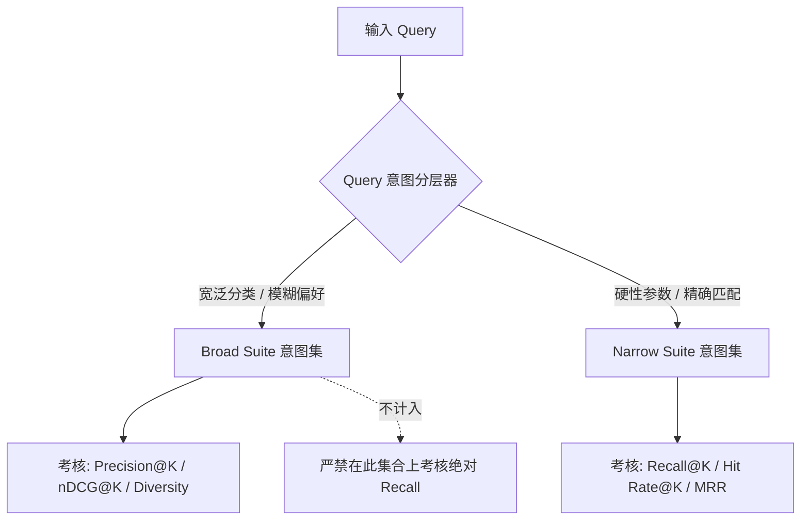
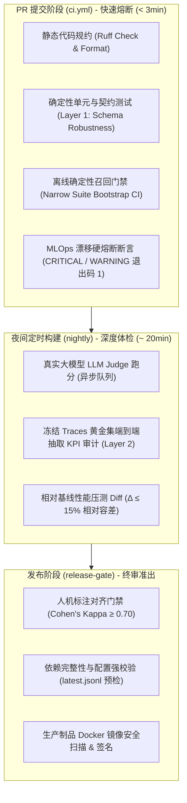

# AutoVend MLOps 门禁系统与评测体系生产级重构方案 (Solution Collection 01)

> 整理说明：针对《01_issue_collection.md》中指出的伪召回率指标欺诈、Mock 循环自证、小样本统计盲区、CI 空气占位符、发布门禁落地崩溃、公共 Runner 性能抖动及测试哲学败坏等八大工程硬伤，提供彻底消除作弊、具备统计置信度与工业级熔断能力的 MLOps 质量工程重构方案。

---

## 目录
1. [第一阶段：P0 止血与拔雷（1~2 天内立即执行）](#第一阶段p0-止血与拔雷12-天内立即执行)
   - 1.1 [消除 MLOps Drift Gate 的“假动作”，赋予真正的熔断权](#1-消除-mlops-drift-gate-的假动作赋予真正的熔断权)
   - 1.2 [防御性修复 Release Gate 的死链接，杜绝发版崩溃](#2-防御性修复-release-gate-的死链接杜绝发版崩溃)
   - 1.3 [清扫 GHA 远古遗毒与配置混乱](#3-清扫-gha-远古遗毒与配置混乱)
2. [第二阶段：评估体系重构（彻底告别指标造假与循环自证）](#第二阶段评估体系重构彻底告别指标造假与循环自证)
   - 2.1 [废除 capped_recall，建立分层评估（Stratified Evaluation）](#1-废除-capped_recall建立分层评估stratified-evaluation)
   - 2.2 [引入统计显著性检验（Bootstrap 置信区间）](#2-引入统计显著性检验bootstrap-置信区间)
   - 2.3 [终结 KPI 抽取的循环套号：两层解耦测试法](#3-终结-kpi-抽取的循环套号两层解耦测试法)
3. [第三阶段：工程化质量门禁与基线治理](#第三阶段工程化质量门禁与基线治理)
   - 3.1 [废除正则抓取，统一结构化测试协议（Metrics JSON Contract）](#1-废除正则抓取统一结构化测试协议metrics-json-contract)
   - 3.2 [公共 Runner 上的基准测试方案（相对衰减 vs 绝对耗时）](#2-公共-runner-上的基准测试方案相对衰减-vs-绝对耗时)
   - 3.3 [诚实对待未支持功能：善用 @pytest.mark.xfail](#3-诚实对待未支持功能善用-pytestmarkxfail)
4. [总结：真正的生产级三层门禁蓝图](#总结真正的生产级三层门禁蓝图)
   - 4.1 [自动化质量门禁标准流水线架构图](#1-自动化质量门禁标准流水线架构图)
   - 4.2 [分级流水线责任矩阵](#2-分级流水线责任矩阵)
   - 4.3 [落地路线图与验收检查清单](#3-落地路线图与验收检查清单)

---

## 第一阶段：P0 止血与拔雷（1~2 天内立即执行）

在重构指标之前，必须先把 CI 里随时会炸的“空气门禁”和“静默放行”彻底修掉。

### 1. 消除 MLOps Drift Gate 的“假动作”，赋予真正的熔断权

在 `.github/workflows/ci.yml` 中，严禁纯 `print` 的合规表演行为，修改为具备明确非零退出码和告警输出的阻断断言脚本：

```yaml
    # ci.yml 中改为带明确状态码的断言脚本
    - name: Run semantic drift regression check
      run: |
        uv run python -c "
        import sys
        from src.mlops import semantic_drift_detector
        from src.mlops.drift import DriftLevel

        report = semantic_drift_detector.generate_drift_report()
        print(f'Overall Drift Level: {report.overall_level.value}')

        if report.overall_level in (DriftLevel.CRITICAL, DriftLevel.WARNING):
            print('❌ CI Gate Blocked: Semantic drift exceeded safety envelope!', file=sys.stderr)
            for alert in getattr(report, 'alerts', []):
                print(f'  - {alert}', file=sys.stderr)
            sys.exit(1)
        print('✅ Semantic drift check passed.')
        "
```

---

### 2. 防御性修复 Release Gate 的死链接，杜绝发版崩溃

在 `.github/workflows/eval-tiers.yml` 中，为 `evaluation/review/` 建立初始规范或提供 Fallback 容错机制：
1. **正式补齐文件系统基线**：在代码库中正式创建 `evaluation/review/.gitkeep` 与基线样本 `latest.jsonl`，填入经过人工核准的至少 30 条真实黄金标注数据。
2. **显式前置依赖预检**：若团队尚未完成人工标定，立刻在 Release Gate 中将其标记为显式配置依赖，而不是静默依赖不存在的路径：

```yaml
    - name: Check review dataset readiness
      run: |
        if [ ! -f "evaluation/review/latest.jsonl" ]; then
          echo "::error::Release blocked: Human alignment review dataset (latest.jsonl) is missing!"
          echo "Run 'uv run python -m src.eval.review_sample --out evaluation/review/latest.jsonl' to seed annotations."
          exit 1
        fi
```

---

### 3. 清扫 GHA 远古遗毒与配置混乱

- **升级废弃语法**：彻底销毁 `print("::set-output ...")`，全部统一为官方标准：`echo "key=value" >> "$GITHUB_OUTPUT"`。
- **统一工具链规范**：将全仓库所有 workflow 的 `setup-uv` 统一钉死在 `@v5`，统一使用 `uv sync --frozen` 保证依赖确定性。
- **分支条件纠偏**：将 `performance-tests.yml` 中的 `if: github.ref == 'refs/heads/main'` 统一修正为适配当前生产主干的 `refs/heads/master`。
- **删除 Vaporware（空头支票）**：彻底删掉 `echo "would be implemented here"` 这种缺乏工程底线的占位 step；未实现的功能打上 `[TODO: RFC-104]` 并暂时注释，严禁带进活跃 pipeline。

---

## 第二阶段：评估体系重构（彻底告别指标造假与循环自证）

### 1. 废除 capped_recall，建立分层评估（Stratified Evaluation）

#### 为什么真实的 `recall@3` 只有 5.4%？
因为当前测试集混合了两种完全不同性质的检索意图：
- **Broad Query（宽泛意图）**：如 `"Compact SUV"`，库里有 200 辆车都符合。让系统在 Top-3 召回 200 辆车是数学上的不可能事件（上限仅为 $3/200 = 1.5\%$）。
- **Narrow / Targeted Query（精准意图）**：如 `"20-30万 纯电 6座 SUV"`，库里可能只有 4 辆车符合。

正确的解决方案不是去篡改 Recall 的公式定义，而是**拆分 Benchmark 实施分层评价**：



- **Broad Query 评测集**：只考核 Precision@K、nDCG@K 和多样性（Diversity/Novelty）。承认这里不需要 100% 的召回，用户需要的是“推荐的三辆车都对，且有代表性”。
- **Narrow Query 评测集**：严格考核 Recall@K 和 MRR。在这里卡死 **85%+** 的及格线。
- **代码重构**：在 `src/eval/metrics.py` 中彻底删掉 `capped_recall_at_k`，还指标一个纯粹严谨的数学定义。

```python
"""
src/eval/metrics.py: Clean, honest IR metrics.
"""
from typing import Sequence, Set
import numpy as np


def recall_at_k(retrieved: Sequence[str], relevant: Set[str], k: int) -> float:
    """True fraction of relevant items retrieved in top k."""
    if not relevant:
        return 0.0
    hits = sum(1 for item in retrieved[:k] if item in relevant)
    return hits / len(relevant)


def precision_at_k(retrieved: Sequence[str], relevant: Set[str], k: int) -> float:
    """Fraction of retrieved top k items that are relevant."""
    top = retrieved[:k]
    if not top:
        return 0.0
    return sum(1 for item in top if item in relevant) / len(top)
```

---

### 2. 引入统计显著性检验（Bootstrap 置信区间）

别再硬编码 `TOLERANCE = 0.02` 这种拍脑袋数字。线上推荐和搜索系统的门禁必须基于统计学。

在 `src/eval/statistical_gate.py` 中引入 Bootstrap 置信区间计算：

```python
# src/eval/statistical_gate.py 规范实现
import numpy as np
from typing import Tuple, List


def bootstrap_metric_ci(
    scores: List[float],
    n_bootstraps: int = 1000,
    ci: float = 0.95,
) -> Tuple[float, float, float]:
    """通过 Bootstrap 重采样计算指标的 95% 置信区间"""
    bootstrapped_means = []
    rng = np.random.default_rng(seed=42)
    scores_arr = np.array(scores)
    n = len(scores_arr)

    for _ in range(n_bootstraps):
        sample = rng.choice(scores_arr, size=n, replace=True)
        bootstrapped_means.append(np.mean(sample))

    lower_bound = float(np.percentile(bootstrapped_means, (1 - ci) / 2 * 100))
    upper_bound = float(np.percentile(bootstrapped_means, (1 + ci) / 2 * 100))
    return lower_bound, float(np.mean(scores_arr)), upper_bound
```

#### 门禁判定规则：
$$\text{新版本的 Lower Bound} < \text{旧版本 Baseline} - \text{Non-Inferiority Margin}$$
**只有当上述不等式成立时，才判定为不可接受的质量退化（红单阻断）！**

这样不仅能免疫 1~2 个边缘用例翻转带来的随机抖动，还能逼着系统在真正出现显著质量劣化时才触发报警。

---

### 3. 终结 KPI 抽取的循环套号：两层解耦测试法

把现有的 `tests/test_kpi_extraction.py` 拆解为两个完全隔离的测试领域，绝不允许再出现 Mock LLM 返回的 JSON 直接拷贝自 `expected` 这种糊弄审查的操作：

| 测试层次 | 职责范围 | 实现方式 | CI 归属 |
|---|---|---|---|
| **Layer 1: Schema & Robustness**<br>*(确定性契约测试)* | 验证 Pydantic 解析、字段脏数据清洗、容错回退机制 | 构造极端脏数据（残缺 JSON、Markdown 代码块包裹、缺失字段、类型溢出），断言系统不崩溃且能降级回退 | `ci.yml`<br>*(PR 阶段必跑，< 10秒)* |
| **Layer 2: Extraction Ground Truth**<br>*(离线冻结样本集测试)* | 验证针对自然语言真实意图的提取召回率与准确率 | 使用人工深度标注的冷冻会话流（Frozen Golden Conversations），通过脱机录制的 LLM Traces（VCR.py / 离线 Cache）跑端到端断言 | `eval-tiers.yml`<br>*(Nightly 异步运行)* |

---

## 第三阶段：工程化质量门禁与基线治理

### 1. 废除正则抓取，统一结构化测试协议（Metrics JSON Contract）

不要再在 Bash 里面用 Python 脚本正则匹配 `re.search(r'Average Retrieval Time: ([\d.]+)s')`！日志格式稍微加个空格门禁就直接报废。

- **规范要求**：任何性能、评估脚本一律实现 `--json-out <path>` 参数。
- **协议输出标准** (`metrics_contract.json`)：

```json
{
  "schema_version": "v1.0",
  "timestamp": 1730811000,
  "commit": "6233440",
  "retrieval": {
    "p50_latency_ms": 14.2,
    "p99_latency_ms": 48.7,
    "narrow_recall_at_3": 0.884,
    "broad_precision_at_3": 0.762,
    "mrr": 0.812
  },
  "drift": {
    "overall_level": "normal",
    "embedding_distance": 0.012
  }
}
```

- **自动化 PR Diff 机器人**：CI 使用 GitHub Actions 将 `current.json` 与主干缓存的 `baseline.json` 进行纯数值 Diff，将变化量（$\Delta$）生成 Markdown 表格直接注入到 `$GITHUB_STEP_SUMMARY` 与 PR Summary 中。

---

### 2. 公共 Runner 上的基准测试方案（相对衰减 vs 绝对耗时）

在没有自建 Dedicated Bare-metal Runner（物理专用跑分机）之前，在 GitHub 共享 Runner 上**禁止用绝对耗时（如 `0.1s`）作为硬门禁**！

#### 工业级折中方案：相对基线比率（Relative Regression Margin）
1. 在同一个 CI Job 内，先拉取 `master` 分支的基线代码，跑 50 次取中位数耗时 $T_{\text{base}}$；
2. 运行当前 PR 分支的代码，跑 50 次取中位数耗时 $T_{\text{pr}}$；
3. **门禁断言**：
$$\frac{T_{\text{pr}} - T_{\text{base}}}{T_{\text{base}}} \le 15\%$$

**原理**：只有同一台虚拟机、同一个时间窗口内的相对增量，才能有效抵消掉宿主机 CPU 调度和多租户竞争带来的环境噪声。

---

### 3. 诚实对待未支持功能：善用 `@pytest.mark.xfail`

之前在 `test_performance_metrics.py` 中删掉的价格区间和动力类型测试用例，不要藏在角落里。标准工程做法是显式声明预期失败（Expected Failure）：

```python
import pytest


@pytest.mark.xfail(
    reason="Architecture RFC-12: Multi-constraint engine under development in Sprint 4",
    strict=True,  # 如果有一天突然 pass 了，说明有人修了或者用例被假穿透了，CI 会反向报错提醒你解开！
)
def test_complex_powertrain_and_price_exclusion():
    # 测试复杂动力学与排除逻辑
    pass
```

#### 规范收益：
1. **技术债可见性（Technical Debt Visibility）**：团队所有人都能在测试报告里清晰看到未完工的特性；
2. **杜绝欺骗性注释**：杜绝在测试脚本里硬编码 `# Only test what the system actually supports` 这种遮羞注释；
3. **闭环驱动**：功能一旦开发完成自动变绿（`XPASS` 报红），提醒工程师移除标记，形成健康的红绿闭环。

---

## 总结：真正的生产级三层门禁蓝图

### 1. 自动化质量门禁标准流水线架构图



---

### 2. 分级流水线责任矩阵

| 流水线阶段 | 对应 Workflow | 执行触发源 | 核心卡点指标 | 阻断行为 |
|---|---|---|---|---|
| **PR 提交阶段** | `.github/workflows/ci.yml` | Pull Request / Push to dev | Ruff 代码风格<br>Layer 1 脏数据契约测试<br>Drift Level != CRITICAL/WARNING<br>Narrow Recall CI 下界不劣于 Baseline | **硬阻断 (Block Merge)**<br>流水线必须全绿 |
| **夜间定时构建** | `.github/workflows/eval-tiers.yml` (nightly)<br>`.github/workflows/performance-tests.yml` | 定时 Schedule (03:00 UTC)<br>手动触发 workflow_dispatch | LLM Judge 对齐度<br>Layer 2 抽取真实 F1 ≥ 0.90<br>相对基线性能衰减 $\le 15\%$ | **趋势告警 (Trend & Notify)**<br>输出报告至 Step Summary 并推钉钉/飞书 |
| **正式发布阶段** | `.github/workflows/eval-tiers.yml` (release-gate) | GitHub Release Created | latest.jsonl 真实有效标注样本 ≥ 30<br>Cohen's Kappa $\ge 0.70$<br>Docker 漏洞扫描零 Critical | **发版熔断 (Block Release)**<br>阻止打标签发布 Production 镜像 |

---

### 3. 落地路线图与验收检查清单

- [ ] **P0-1**: 在 `ci.yml` 中为 MLOps drift 检查增加 `sys.exit(1)` 熔断；
- [ ] **P0-2**: 在根目录下创建 `evaluation/review/.gitkeep` 与 `latest.jsonl`，修复发版必定崩溃问题；
- [ ] **P0-3**: 全库升级 `astral-sh/setup-uv@v5`，修正 `refs/heads/master`，清理 `::set-output`；
- [ ] **P1-1**: 在 `src/eval/metrics.py` 中彻底删除 `capped_recall_at_k`，拆分 Broad/Narrow 数据集；
- [ ] **P1-2**: 实现 `src/eval/statistical_gate.py` 的 Bootstrap 置信区间计算与非劣效性检验；
- [ ] **P1-3**: 将 `test_kpi_extraction.py` 重构为 Layer 1（脏数据防御）与 Layer 2（冻结录制集端到端）；
- [ ] **P2-1**: 实现 `--json-out` 结构化测试输出协议与 PR 差异对比机器人；
- [ ] **P2-2**: 消除公共 Runner 绝对耗时写死，切换为相对基线比率检验；
- [ ] **P2-3**: 将未支持用例用 `@pytest.mark.xfail(strict=True)` 正规标示，消除遮羞注释。
